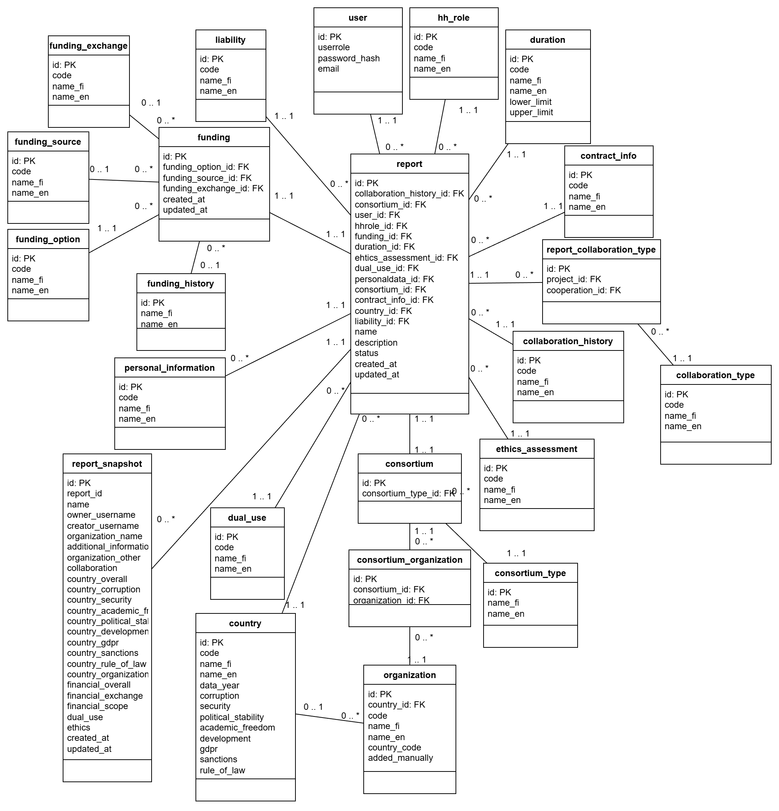

# Database

Database serves two main functions. First is to provide data needed for risk calculation form and second is to store risk calculation reports including a snapshot of the calculation results.

## How the schema is managed

The models in `src/data/models/` describe the tables for the code. The actual database structure is created and changed by **migrations** in `db/migrations/`, see [migrations.md](migrations.md). `db/baseline.sql` contains the exact SQL of all 24 tables (columns, types, keys and indexes) as they were when migrations were introduced, so it is the quickest place to look up real column names. Tables and columns added after that (`report_status` and `report.report_status_id`, see `db/migrations/*-add-report-status.js`) are in their own migrations. Note that the timestamp columns are not named consistently: most tables use `createdAt` / `updatedAt`, and `funding`, `report`, `report_snapshot` and `user` use `created_at` / `updated_at`.

A change to a table is always a change to the model **and** a new migration, in the same pull request. Update this file when tables are added or removed.

## Table explanations

### Miscallaneous

    - user: report owner, report creator, authentication

### Risk calculation

    - report: risk calculation report

    - report_snapshot: snapshot of risk calculation results

    - report_status: status of a report (planned, accepted, rejected, in progress, finished), referenced by `report.report_status_id` (optional)

### Form page content

    - hh_role: Haaga-Helia's role in collaboration

    - duration: Duration of the collaboration

    - contract_info: Status of written agreement for the collaboration

    - collaboration_type: Type of collaboraiton

    - collaboration_history: Previous history with collaboration partners

    - ethics_assessment: Assessment of potential ethical risks involved in the collaboration

    - consortium_type: Whether consortium consist of 2 organizations or more

    - organization: Partnership organization, World Higher Education Database used as source for known organizations

    - country: Country involved in collaboration with scraped data used for risk factors

    - dual_use: Likelihood of use of collaboration resources for military purposes

    - personal_information: Likelihood of transfer of personal information to partner organizations or Countries

    - funding_option: Extarnal funding in collaboration

    - funding_exchange: Whether external funding is in euros or another currency

    - funding_source: Type of organization that provides the external funding

    - funding_history: Previous history with the funding organization

    - liability: Scope Haaga-Helia's financial liability for the collaboration 

### Helper tables

    - funding: combined list of funding choices related to a specific report

    - consortium: consortium for a specific project

    - consortium_organization: organizations in a specific consortium

    - report_collaboration_type: collaboration type choices for a specific report

## Relational model

